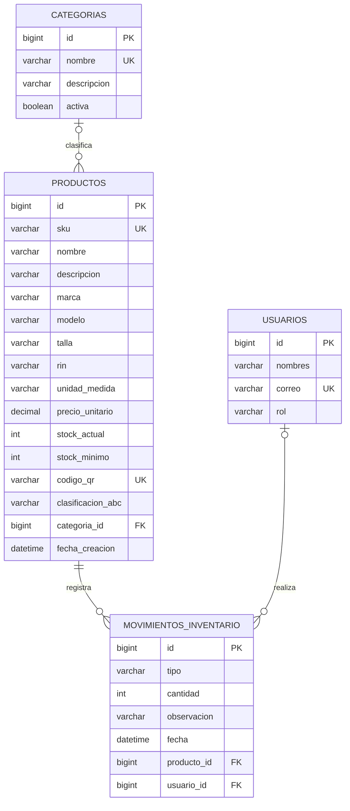

# Diagrama Entidad-Relacion propuesto

Este DER responde a la recomendacion del profesor: vincular el identificador del codigo QR con los registros de la base de datos.



## Relacion entre QR y base de datos

El campo `productos.codigo_qr` almacena el identificador interno de la referencia. El valor conserva esta estructura:

```text
PATC-INVENTARIO;PRODUCTO_ID=1;SKU=BIC-MTB-29-M
```

De esta forma, al leer el QR, el sistema puede buscar el producto asociado en la tabla `productos` por medio del campo `codigo_qr`, y tambien puede identificar el `PRODUCTO_ID` y el `SKU`.

La imagen QR generada contiene un enlace web a `/producto.html?id=...`, con la dirección actual del servidor. El lector reconoce tanto ese enlace como el identificador interno. El código interno no debe confundirse con la URL de la imagen.

Marca y modelo describen la referencia; talla y rin distinguen variantes cuando se necesitan saldos separados. Esos campos son opcionales. El modelo agrupa unidades por SKU y no identifica el serial físico de cada bicicleta.
